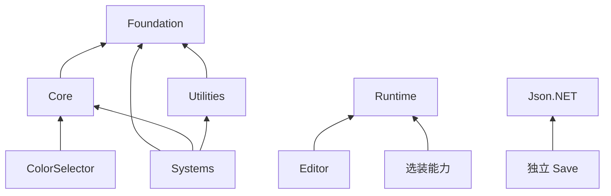

# YLFramework 架构

> [文档首页](README.md) · [安装指南](Installation.md) · [代码规范](CodingStyle.md)

本文解释当前产品分层、程序集依赖、装配与所有权。操作和 API 用法归各模块手册，源码仓库流程见源码当前的[贡献指南](https://github.com/KONOK-A/YLFramework-dev/blob/main/CONTRIBUTING.md)。

## 产品边界

主包提供 Foundation、Core、Systems、Utilities 四个职责区，共用 `YLFramework.Runtime` 与 Editor-only 的 `YLFramework.Editor`。独立能力按 UPM 包选择，不要求使用一个工具就启动所有系统。

| 内容 | 所有者与边界 |
| --- | --- |
| Runtime / Editor | 正式框架实现与作者工具 |
| Prefabs / Resources | 随包的默认模板与运行资产 |
| `Documentation~` / `Samples~` | 按文件路径打开的说明，以及显式 Import 后才编译的样例 |
| 选装包 | 配置、本地化、存档、状态机、二维移动、检测、玩法、红点、Excel、HybridCLR |
| `Plugins/BouncyCastle` | 随包依赖及来源许可，不等于依赖整个宿主 Plugins |
| `Assets/Tests/YLFramework` / `Tools` | 源码仓库的测试和工具，不进入产品包 |
| `Assets/YLFrameworkData` | 使用工程自己的配置与生成内容，不属于框架包输入 |

`YLFrameworkDev` 场景、宿主 ProjectSettings、MCP 和商业 Editor 插件只服务开发宿主。框架包、Resource 发布内容与 HybridCLR 基座是不同交付物，不能相互覆盖或混为一份安装输入。

## 目录与程序集

```text
PackageSources/
  com.kano.ylframework/
    Runtime/  Foundation/  Core/  Systems/  Utilities/
    Editor/   Foundation/  Core/  Systems/  Common/  Tools/  Help/  Distribution/
    Plugins/  Prefabs/  Documentation~/  Samples~/ResourceStartup/
    package.json  README.md  CHANGELOG.md  LICENSE.md
  com.kano.ylframework.data-assets/
  com.kano.ylframework.localization/
  com.kano.ylframework.save/
  com.kano.ylframework.state-machine/
  com.kano.ylframework.movement2d/
  com.kano.ylframework.overlap/
  com.kano.ylframework.gameplay/
  com.kano.ylframework.reddot/
  com.kano.ylframework.excel/
  com.kano.ylframework.hybridclr/
```

安装后的主包逻辑根是 `Packages/com.kano.ylframework`。`Documentation~` 与 `Samples~` 不进入 AssetDatabase，前者按实际磁盘路径打开，后者导入为使用工程副本后才编译。业务有 asmdef 时须显式引用所属程序集，`autoReferenced` 不能替代 asmdef 引用。

| 程序集 | 依赖与条件 |
| --- | --- |
| `YLFramework.Runtime` | Unity / UGUI、Json.NET、BouncyCastle，不引用框架 Editor |
| `YLFramework.Editor` | 主 Runtime、UGUI、Json.NET，仅 Editor；Help 共用该主体 |
| `YLFramework.DataAssets` / `.Editor` | 主包与自身 Runtime，Editor 不引用 Excel |
| `YLFramework.Localization` / `.Editor` | 主包、UGUI 与自身 Runtime，不依赖 DataAssets/Excel |
| `YLFramework.Save` | Json.NET 与 UnityEngine，不依赖主包；普通 DTO/BCL 存储与主包字典组合可分别使用 |
| `YLFramework.StateMachine` / `.Editor` | 主包与自身 Runtime，配置式执行内核独立于主包轻量 FSM |
| `YLFramework.Character2D` / `YLFramework.Platform2D` | 同属 Movement2D，各引用主 Runtime，不互相引用；作者工具归 `YLFramework.Movement2D.Editor` |
| `YLFramework.Overlap` / `.Editor` | 主包和物理模块，不依赖 Movement2D、Gameplay 或 Save |
| `YLFramework.Skill` / `YLFramework.Buff` / `YLFramework.Mission` / `YLFramework.Equipment` | 同属 Gameplay，各引用主 Runtime，Buff/Mission 引用 Json.NET；统一作者工具为 `YLFramework.Gameplay.Editor` |
| `YLFramework.RedDots` / `.Editor` | 主包、红点核心与只读诊断工具，不强装 Save |
| `YLFramework.Excel.Editor` | 主 Runtime/Editor、DataAssets Runtime/Editor、MiniExcel、Json.NET，仅 Editor |
| `YLFramework.HybridCLR` / `.Editor` | 主包与官方 HybridCLR SDK；dnlib 仅 Editor，业务显式引用，主体不反向依赖 |
| `YLFramework.Actions.DOTween` | 主包内的条件程序集，外置 DOTween.dll 与 `DOTWEEN` 同时成立才启用，需显式引用 |
| `YLFramework.RedDots.Save` | RedDots 包内条件适配，由真实 Save 包的 Version Define 启用 |
| `YLFramework.Domain.Excel.Editor` | Excel 包内 Gameplay 适配，由真实 Gameplay 包的 Version Define 启用 |

两个主体和普通选装程序集启用自动引用；HybridCLR 与 DOTween 适配不启用。平台、define、预编译白名单及 Sample 的独立 asmdef 以实际 `.asmdef`/`.asmref` 为准，完整依赖来源见[安装指南](Installation.md)。

namespace 表达功能域，不机械复制物理目录，例如 `YLFramework.DependencyInjection`、`Pooling`、`Actions`、`RedDots`、`Character2D`、`Platform2D`。类型名、程序集、字段、资源地址和 JSON/Excel 键是不同身份，`rootNamespace` 也不会改写现有类型声明。

## 依赖方向



图表示代码层依赖，不能从同一个 Runtime DLL 推导出内部任意引用合法。

| 职责区 | 责任与约束 |
| --- | --- |
| Foundation | 异步、事件、池、计时、更新、注入、序列化及必要 Unity 适配，不反向消费 Core / Systems / Utilities |
| Core | Module / MVC / View / Panel、UI 会话与窄资源合同，不绑定具体 Resource 实现 |
| Systems | Resource、Audio、Action、HTTP、Logging 等明确系统，通过合同协作 |
| Utilities | 数据结构、扩展、轻量 FSM 与控件；有明确需要时消费 Core，不升级为全局系统 |

Foundation 的 Unity 挂载/销毁直接使用原生 API。ColorSelector 是消费 Core Panel 的 UI 控件，Core 不反向依赖取色实现。Runtime 内条件使用的编辑器 API 由 `#if UNITY_EDITOR` 隔离，Player 不引用 UnityEditor。

### Core 职责归口

| 所有者 | 责任 |
| --- | --- |
| Module / ModuleManager | 注册、启动、关闭及业务 Models / Controllers / Views / Panels |
| View / ViewManager | 表现会话、索引、加载、查询与归还；Panel 复用此生命周期 |
| PanelManager / UIRootContext | 根、层、遮罩、排序与输入协调，不拥有第二份资源缓存 |
| SceneController | 经 `ICoreResourceProvider` 提交场景请求；成功 Scene 的卸载权由接收方持有 |
| CoreEvents | 领域事件键；View 使用 Foundation EventBus 的共享上下文 |
| 默认资源与 Analyzer marker | Core 的配置和编译元数据；Analyzer DLL 是编译器输入，不是运行时系统 |

### 跨系统协作

- Resource 为 Core 安装资源适配，Core 不直接依赖具体加载器。
- Resource → Audio 的装配在 `Systems/Resource/Integration/Audio`，命名 Provider 用资源租约保活，ResourceSystem 仍是资产和 Bundle 的释放权威。
- `Systems/Audio/Actions/PlaySoundAction` 是同一 Runtime 内的 Action/Audio 协作；DOTween 则是有外部 SDK 前置的条件适配。
- Localization、DataAssets 与 Gameplay 配置可以借用 ResourceSystem，不另建资源下载或底层释放权威；主包不反向引用它们。

| 能力 | 调度边界 |
| --- | --- |
| Timing | 秒、帧、日期投递与作用域，不提供统一全局任务表 |
| Action | 逐帧进度、插值、条件与组合，不自动取得音频资源权 |
| Audio | 播放、逻辑取消与代次句柄，不替 Resource 释放 Bundle |
| HTTP / Async | HTTP 独占传输并处理稳定终态；异步基类只提供等待与通知，不替请求定义传输取消 |

这些能力的时钟、首帧、循环与异常语义按各模块定义，不为了形式统一而合并调度器。

## 装配与所有权

`Runtime/YLFrameworkRoot.cs` 是常驻宿主与 UI 装配入口，不是自动启动器。纯工具不要求 Root/Module；应用决定资源、Provider、业务 Module 的初始化与关闭顺序。

| 资源或会话 | 释放责任 |
| --- | --- |
| 资产、实例与场景 | ResourceSystem 管底层共享内容，消费者持 lease，不擅自卸载共享 Bundle |
| Module / View / Panel | 所属 Module 清理注册、业务对象和在途工作，不因关闭一个模块而关闭全局服务 |
| 命名音频 | 先停播放，再归还 Provider 和资源租约 |
| 配置登记 | 先结束使用配置的业务与 UI，再归还登记句柄和根资源 |
| Gameplay 运行态 | Skill/Buff/Equipment 按宿主结束，Mission 按任务配置结束 |
| Timer / Action / HTTP | 创建或登记者结束自身工作；等待完成不自动等于成功、取消或资源已归还 |

共享定义与实例状态分离。重入、池化复用、停用/销毁、场景结束、禁用 Domain Reload 时都需保留准确的会话身份，避免迟到回调作用于新的使用者。

## Editor 与生成内容

Editor 按 Runtime 所有者组织。`YLFramework.Editor.Common` 提供中立资产、Inspector、Scene、Settings、TreeView 和 Window 支撑；领域作者策略归所属选装包，例如 Gameplay 的 `Editor/Shared` 与 Overlap 的 `Editor/OverlapDetectorInspector.cs`。

Module 生成输出为 `Assets/YLFrameworkData/Generated/Modules`，SO 创建助手默认为 `Assets/YLFrameworkData/ScriptableObjects`。作者工具须尊重 Undo、Prefab、只读包输入、未知输出与脏场景，不自动覆盖项目内容。详见 [Editor](Modules/Editor.md)和[UI 资产准备](Modules/UI.md#资产准备)。

Help 按显式类型与真实编译器 XML 构建索引。`Runtime/csc.rsp` 生成主体 XML，DOTween 有独立 XML 配置；`Library` 中的 XML 是生成物，不随包分发，缺失时只显示可反射声明，不伪造 API 说明，见 [Help](Modules/Help.md)。

`Runtime/Core/Analyzers/YLFramework.Analyzers.dll` 通过 `RoslynAnalyzer` 标签生效，不是 Player 插件。Analyzer SDK 链接编译 Editor 下 BCL-only 的规则目录，两边不互相引用程序集，规则、配置和重建只维护在 [Attributes](Modules/Attributes.md#core-使用诊断)。

## 可选集成

默认产品不能静态依赖未安装的 SDK、供应商 DLL 或全局宏，安装选择见[选装能力](README.md#选装能力)。

HybridCLR 复用唯一 ResourceSystem。构建流程完成生成、剥离、metadata、资源发布/部署与 Player 后冻结基线；补丁只读基线，不重新剥离或修改基座。SDK、native、裁剪与基座组成实际执行前置，不是普通包更新就能替换的输入。

运行时先关闭 loader 启动的 Module，再 Dispose loader，最后关闭应用拥有的资源系统。Dispose 不卸载程序集，部分不可逆失败或同进程内容冲突要求重启。Native、EditorSimulation、EditorFast 是不同执行模式，详细用法见源码当前的 [HybridCLR 手册](https://github.com/KONOK-A/YLFramework-dev/blob/main/PackageSources/com.kano.ylframework.hybridclr/Documentation~/README.md)。

框架的测试与夹具不进入默认产品包。分层守卫、实际 Unity 编译、生命周期测试、独立安装与 Player 是不同证据；测试流程只维护在源码当前的[测试工具说明](https://github.com/KONOK-A/YLFramework-dev/blob/main/Tools/Testing/README.md)，架构页不记录阶段回执或测试数量。
