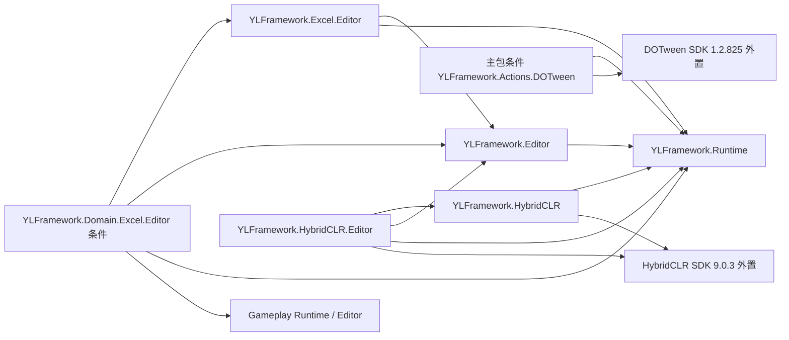

# YLFramework

YLFramework 是一个面向 Unity 的开源 C# 游戏开发框架。

项目围绕日常游戏开发，整合常用基础能力、游戏系统和编辑器工具，减少不同项目中重复搭建基础设施的工作。

本仓库 `YLFrameworkDev` 用于框架开发、验证与发行，不是游戏工程或游戏模板。维护者为 Kano，原版权署名 KONOK-A 保留；仓库地址为 <https://github.com/KONOK-A/YLFramework-dev>。

## 主要方向

- 基础能力：事件、对象池、计时器、依赖注入和数据绑定。
- 项目组织：业务模块、MVC、UI 面板与窗口管理。
- 游戏系统：资源、音频、存档、本地化，以及技能、Buff、任务等常用系统。
- 编辑器工具：配置编辑、资源构建和开发辅助工具。

## 开发状态

首个 UPM 版本为 `0.1.0-preview.1`，功能、API 与模块结构尚未稳定。当前开发宿主使用 Unity `6000.3.27f1`；兼容目标与各能力的精确平台限制见[产品文档](PackageSources/com.kano.ylframework/Documentation~/README.md)。版本号与目标矩阵不表示已经完成当前提交的安装、编译、Player 验收或对外发布。

## 产品与安装

产品源码统一放在 `PackageSources/`，开发宿主通过本地 `file:` 依赖按需接入。消费方使用 UPM，不再提供 `.unitypackage` 导入/导出出口，也不复制宿主的 `Assets`、`Packages` 或 `ProjectSettings`。

| 包 | 内容 |
| --- | --- |
| [`com.kano.ylframework`](PackageSources/com.kano.ylframework/README.md) | Runtime / Editor 主体、正式资源、文档、需显式导入的 Resource Startup 样例及条件 DOTween Action 适配；不含 SDK |
| [`com.kano.ylframework.reddot`](PackageSources/com.kano.ylframework.reddot/README.md) | 独立路径红点、来源凭据和原指示组件；不要求Save或Gameplay |
| [`com.kano.ylframework.excel`](PackageSources/com.kano.ylframework.excel/README.md) | 完整Editor工作簿作者流程，附MiniExcel/许可；同装Gameplay时启用内置领域适配，无独立DomainExcel包 |
| [`com.kano.ylframework.hybridclr`](PackageSources/com.kano.ylframework.hybridclr/README.md) | 可选热更适配，官方 SDK `9.0.3` 与匹配的 native 外置 |

主要脚本依赖方向如下（不展开 Unity / Json.NET 等底层引用）；现有程序集名和 namespace 保留，不将每个功能目录拆成 DLL：

主包不含 MCP、开发宿主、测试或独立选装包。DOTween 适配源码随主包提供，但只在外部 SDK 和 `DOTWEEN` 前置成立时编译。UGUI / Newtonsoft.Json 等 Registry 依赖由 UPM 按包声明解析；自有 Git 包及其 Git 闭包则须在消费工程 manifest 中逐项显式声明。安装方式、完整 SHA 的交付约定与样例导入见[安装文档](PackageSources/com.kano.ylframework/Documentation~/README.md#安装与分发)，旧工程升级见 [Migration-UPM](PackageSources/com.kano.ylframework/Documentation~/Migration-UPM.md)。不要把本文的版本号当作已经发布的 tag 或可用 Git 修订。

仓库测试位于 `Assets/Tests/YLFramework`，工具入口见[测试工具说明](Tools/Testing/README.md)，均不随产品交付。

## 许可证

YLFramework 以 [MIT License](LICENSE) 开源。第三方源码署名与 BouncyCastle 许可见[主包版权声明](PackageSources/com.kano.ylframework/LICENSE.md)，选装依赖按各包的 `LICENSE.md` 和 `Dependencies.json` 保留来源与条款。
